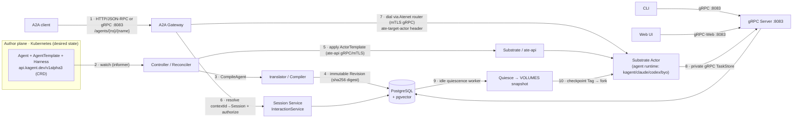
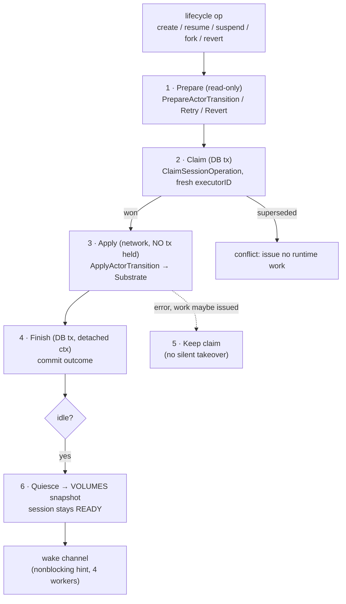

# kagent — Architecture Overview

> Team-maintained, verified-from-code architecture overview of kagent. This is a
> companion to the upstream [`docs/architecture/`](architecture/README.md) deep-dive
> documents; it provides a single-page diagram-first view of the whole system and
> its core mechanism.
>
> Every claim below is traceable to real source files (`file:line` references are
> given). See also the per-subsystem documents under `docs/architecture/`.

kagent is a Kubernetes-native control plane for defining, compiling, running, and
invoking AI agents. Kubernetes stores the *desired* agent configuration; PostgreSQL
stores *runtime* state (identity, A2A history, lifecycle); **Substrate Actors** are
the compute backend that actually run the agent processes.

---

## 1. Complete System Architecture

**Point-by-point (numbers map to the diagram):**

1. **Public invocation ingress** — an A2A client hits the gateway at path prefix
   `/agents/{namespace}/{name}` over **HTTP/JSON-RPC** (streaming via SSE) *or*
   **gRPC**, both on the single listener `:8083`
   (`go/core/internal/a2agateway/http.go:19,22,33,69`; `docs/architecture/a2a-transports.md:3-5`).
2. **Desired-state watch** — the controller `Reconciler` watches
   `Agent`/`Harness`/`AgentTemplate` CRDs through controller-runtime informers
   (`controller.NewReconciler`, wired in `go/core/pkg/app/app.go:322-328`).
3. **Compilation** — on reconcile, `Compiler.CompileAgent` resolves the template
   tree + harness and produces an immutable revision
   (`go/core/internal/translator/compiler.go:102,148`).
4. **Persist revision** — the compiled `Revision` is keyed by a SHA-256 `Digest()`
   of every runtime-affecting input and stored atomically with its bootstrap
   bundle via `RecordRuntimeRevision`
   (`go/core/internal/translator/revision.go:94`; `go/core/internal/database/runtime_revisions.go:122`).
5. **Apply to Substrate** — the controller applies the revision as an **ate-api
   ActorTemplate** over gRPC; compilation and application are deliberately separate
   (`go/core/pkg/app/app.go:305-316`; `docs/architecture/README.md:78-83`).
6. **Session resolution + authorization** — the gateway resolves the Agent tenant,
   then delegates `contextId`/`taskID`→`Session` mapping and ownership/share
   authorization to the Session `InteractionService`
   (`go/core/internal/a2agateway/routing.go:15-21`; `go/core/internal/a2agateway/interactions.go:29,67,120`).
   `Session.id` *is* the A2A context ID.
7. **Route to Actor** — the `RuntimeDialer` never addresses the Actor directly; it
   dials the private **Atenet router** over mTLS gRPC and sets the
   `ate-target-actor` header derived from the session's authority
   (`go/core/internal/a2agateway/runtime.go:42-43,89`; `go/core/internal/substrate/router.go:15-32`).
8. **Durable task persistence** — the agent runtime inside the Actor writes task
   state + append-only history back through the **private gRPC TaskStore** service
   (`go/core/internal/service/taskstore/service.go:59,93,161`; `docs/architecture/a2a-gateway.md:50-54`).
9. **Idle quiescence** — a non-leader worker on every replica claims idle sessions
   and `Quiesce`s their Actors to a VOLUMES snapshot while the session stays
   logically READY
   (`go/core/internal/service/session/quiescence.go:34-73`; `go/core/internal/service/session/workflow.go:56-92`).
10. **Checkpoint / fork** — a checkpoint copies the Actor's snapshot into an
    independent **Tag**; a fork cold-boots a *new* Session + Actor from that Tag
    with fresh identity
    (`go/core/internal/service/checkpoint/service.go:136-188`; `docs/architecture/persistence-checkpoints-and-forks.md:108-135`).

### Protocols & ports

- All public + private control-plane APIs share one listener: **`:8083`** — gRPC,
  gRPC-Web, A2A (HTTP/JSON-RPC + gRPC), `/mcp`, and `/.well-known/jwks.json`
  (`go/core/pkg/config/defaults.go:42`; `go/core/pkg/app/app.go:459-498`; `docs/architecture/a2a-transports.md:3-5`).
- A2A public HTTP path prefix: **`/agents/{namespace}/{name}`**
  (`go/core/internal/a2agateway/http.go:19,35-36`).
- Control plane → Substrate: **ate-api gRPC** with mutual TLS
  (`go/core/internal/substrate/client.go:31-93`).
- Gateway → Actor: **mTLS gRPC through the Atenet router**
  (`go/core/internal/substrate/router.go:13-33`).
- PostgreSQL: `pgx/v5` pool; **pgvector** for long-term memory
  (`go/core/internal/database/connect.go`, `go/core/internal/database/memory.go`).
- Metrics: Prometheus, bind address **off (`"0"`)** by default
  (`go/core/pkg/config/defaults.go:51`).

---

## 2. Core Mechanism — Session ⇄ Substrate Actor Lifecycle

The single most important mechanism is how a **durable conversation** (PostgreSQL)
safely drives an **ephemeral, replaceable compute shell** (an Actor) across
create / suspend / resume / crash-recover — **without ever holding a database
transaction across a network call**.

**Point-by-point (numbers map to the diagram):**

1. **Prepare (read-only)** — `PrepareActorTransition` / `PrepareActorRetry` /
   `PrepareActorRevert` compute the intended transition and load the pinned
   revision/snapshot *before* any durable claim; they hold no lock and may run
   concurrently (`go/core/internal/substrate/lifecycle.go:69-142`; `go/core/internal/service/session/workflow.go:125-129`).
2. **Claim (DB transaction)** — `run`→`execute` atomically claims the operation
   with a fresh `executorID` via `ClaimSessionOperation`; exactly one caller wins,
   a superseded generation returns a conflict and issues **no** runtime work
   (`go/core/internal/service/session/workflow.go:115-123,185-197`).
3. **Apply (network, no transaction held)** — `ApplyActorTransition` dispatches
   CREATE/RESUME/SUSPEND/REVERT/DELETE against the Substrate `LifecycleClient`
   entirely outside any DB transaction. Actors are created **SUSPENDED**, then the
   session is marked READY only after Substrate accepts
   (`go/core/internal/substrate/lifecycle.go:146-220`; `docs/architecture/runtime-and-lifecycle.md:19-22`).
4. **Finish (DB, detached context)** — completion commits through a
   `context.WithoutCancel` + 5s context so a disconnected client cannot discard a
   known outcome (`go/core/internal/service/session/workflow.go:214-217`).
5. **Uncertain failure keeps the claim** — if the network step errors after work
   may have been issued, the claim is retained (it does not auto-expire) because
   losing the worker does not prove the suspend/delete stopped — no silent takeover
   (`go/core/internal/service/session/workflow.go:223-247`; `go/core/internal/service/session/quiescence.go:80-84`).
6. **Idle quiescence + wake channel** — settlement fires a bounded, single-slot
   nonblocking `wakeQuiescence()` hint; four workers drain claims from PostgreSQL,
   suspend the Actor to a VOLUMES snapshot, and on a DB-write failure retry only
   the write — **never re-issuing the Substrate suspend**
   (`go/core/internal/service/session/quiescence.go:21-29,34-103`).

**Why this is the core:** if a transaction were held across the Substrate call, or
a claim silently expired, two workers could both suspend/replace an Actor, orphan
compute, or lose the durable snapshot that checkpoints and forks depend on. The
deterministic `ActorName(sessionID) = "session-"+lower(sessionID)` plus UID
re-verification (`go/core/internal/substrate/client.go:283-284`;
`go/core/internal/service/session/workflow.go:176-183`) guarantees a same-name
replacement is never adopted.

---

## 3. Component Responsibilities

| Component | Single responsibility |
| --- | --- |
| **Kubernetes CRDs** (`go/api/v1alpha3`) | Declare agent *behavior* (Agent/Harness/AgentTemplate/…); do not expose backend mechanics |
| **Controller / Reconciler** (`go/core/internal/controller`) | Reconcile CRDs into compiled revisions and apply them via ate-api |
| **Translator / Compiler** (`go/core/internal/translator`) | Resolve the reference tree → compile into an immutable, content-addressed revision (no apply/transport) |
| **A2A Gateway** (`go/core/internal/a2agateway`) | The only public invocation path; authorization, routing, observation streams |
| **Session Service** (`go/core/internal/service/session`) | contextId→Session mapping, authorization, lifecycle orchestration |
| **Substrate / Actor** (`go/core/internal/substrate`) | Compute backend; Actor lifecycle + private network + DurableDir |
| **PostgreSQL + pgvector** (`go/core/internal/database`) | Transactional persistence of sessions, tasks, A2A events, revisions, checkpoints, memory |
| **Harness runtimes** (`go/harness`) | Actor-side runtimes that run the native agent process (kagent/claude/codex/byo) and translate native events into the shared event model |

---

## 4. Harnesses and the Agent SDK

A `Harness` is a Kubernetes CRD that selects **exactly one** runtime adapter
(`ExactlyOneOf=kagent;codex;claude;byo`, `go/api/v1alpha3/harness_types.go:141-157`):

| Harness type | Runtime | SDK / engine |
| --- | --- | --- |
| `kagent` | kagent's own Go/Python ADK runtime | **Google ADK** (`google.golang.org/adk/v2` in `go/go.mod`; `google-adk` in `python/packages/kagent-adk/pyproject.toml`) wrapped by kagent's ADK layer (`go/adk`, `python/packages/kagent-adk`) |
| `claude` | Claude Code CLI | Anthropic Claude Code binary |
| `codex` | Codex App Server | OpenAI Codex |
| `byo` | Bring-your-own image | User image implementing kagent's private A2A contract |

The **kagent** harness is built on **Google ADK**. kagent's own `go/adk` and
`python/packages/kagent-adk` are a thin wrapper around Google ADK that adds kagent
MCP tool integration, the pgvector-backed memory service, the A2A contract,
human-in-the-loop tool confirmation, STS credentials, and output schema handling
(`go/adk/pkg/agent/agent.go` imports `google.golang.org/adk/v2/agent`,
`.../llmagent`, `.../model/gemini`, `.../tool/toolconfirmation`, …). Only the
`kagent` harness uses this Google-ADK-based path; `claude`, `codex`, and `byo` are
entirely different runtimes.

---

## 5. Observed Deployment (local kind cluster `kind-kagent`)

Verified live against the local kind cluster on 2026-11-12 (read-only):

- **Control-plane pods** (namespace `kagent`): `kagent-controller`, `kagent-ui`,
  `kagent-tools`, `kagent-postgresql`, plus the default worker pool.
- **Substrate** installed (`ate-system` namespace; `*.ate.dev` CRDs:
  `workerpools`, `sandboxconfigs`, `csidriverconfigs`).
- **Harnesses present:** `kagent-default` (spec `kagent: {}`), `claude-default`,
  `codex-default`.
- **Running Agent:** `my-agent` (READY=True) → `harnessRef: kagent-default`
  (the **Google-ADK-based** kagent harness) → template `incident-responder`.
- **Model:** `ModelConfig default-model-config`, provider **OpenAI**, model
  **gpt-5.5** (locally routed through the SAP HAI Proxy LiteLLM backend; see the
  local network adaptations on branch `local/sap-network-adaptations`).

No active Substrate Actor Pod was observed, which is consistent with the lifecycle
model: an Agent being READY does not mean an Actor is currently running — idle
sessions are quiesced to a snapshot and cold-resumed on the next authorized call.

---

_Sources: this document is distilled from the kagent source tree and the upstream
`docs/architecture/` documents. A longer bilingual exploration with full
`file:line` references is kept locally under `.project-exploration/` (gitignored)._
