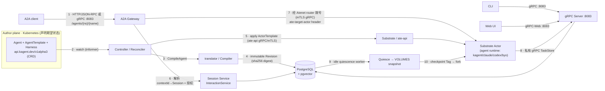
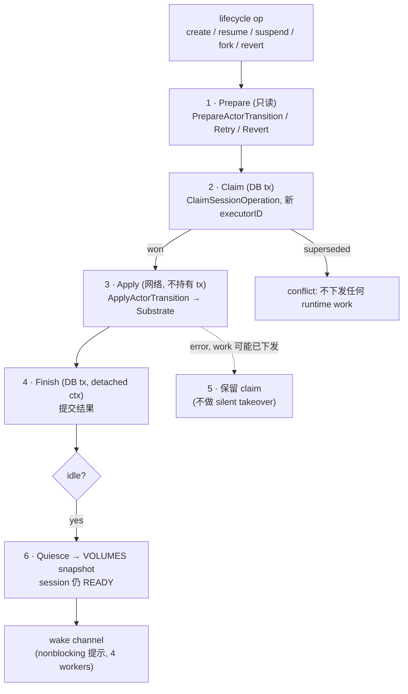

# kagent — 架构总览

> 团队维护、从代码核实的 kagent 架构总览。它是上游 [`docs/architecture/`](architecture/README.md)
> 深入文档的伴生文档,提供一张图优先、单页呈现的整体系统视图及其核心机制。
>
> 下文每条论断都可追溯到真实源码(给出 `file:line` 引用)。另见 `docs/architecture/`
> 下的各子系统文档。

kagent 是一个 Kubernetes-native 的 control plane,用于定义、编译、运行和调用 AI agents。
Kubernetes 存储*期望*的 agent 配置;PostgreSQL 存储*运行时*状态(identity、A2A history、
lifecycle);**Substrate Actors** 是真正运行 agent 进程的 compute backend。

---

## 1. 整体系统架构

_图注:整体系统图。左侧为 Kubernetes 上的 author plane(声明期望状态),右侧为运行时调用路径;节点标签保留英文标识符与协议名。_

**逐点说明(编号对应图中的边):**

1. **公开调用入口** — A2A client 经路径前缀 `/agents/{namespace}/{name}`,以
   **HTTP/JSON-RPC**(流式走 SSE)*或* **gRPC** 访问 gateway,二者共用监听器 `:8083`
   (`go/core/internal/a2agateway/http.go:19,22,33,69`;`docs/architecture/a2a-transports.md:3-5`)。
2. **期望状态 watch** — controller `Reconciler` 通过 controller-runtime informer 监听
   `Agent`/`Harness`/`AgentTemplate` CRD
   (`controller.NewReconciler`,在 `go/core/pkg/app/app.go:322-328` 装配)。
3. **编译** — reconcile 时,`Compiler.CompileAgent` 解析 template 树 + harness,产出一个
   immutable revision(`go/core/internal/translator/compiler.go:102,148`)。
4. **持久化 revision** — 编译出的 `Revision` 以其所有运行时相关输入的 SHA-256 `Digest()`
   为 key,与其 bootstrap bundle 原子性地写入 PostgreSQL
   (`go/core/internal/translator/revision.go:94`;`go/core/internal/database/runtime_revisions.go:122`)。
5. **应用到 Substrate** — controller 把 revision 作为 **ate-api ActorTemplate** 通过 gRPC
   应用;编译与应用被刻意分离
   (`go/core/pkg/app/app.go:305-316`;`docs/architecture/README.md:78-83`)。
6. **Session 解析 + 授权** — gateway 解析 Agent tenant,然后把 `contextId`/`taskID`→`Session`
   的映射以及 ownership/share 授权交给 Session `InteractionService`
   (`go/core/internal/a2agateway/routing.go:15-21`;`go/core/internal/a2agateway/interactions.go:29,67,120`)。
   `Session.id` *就是* A2A 的 context ID。
7. **路由到 Actor** — `RuntimeDialer` 从不直接寻址 Actor;它通过 mTLS gRPC 拨号到私有的
   **Atenet router**,并根据 session 的 authority 设置 `ate-target-actor` header
   (`go/core/internal/a2agateway/runtime.go:42-43,89`;`go/core/internal/substrate/router.go:15-32`)。
8. **durable task 持久化** — Actor 内部的 agent runtime 通过**私有 gRPC TaskStore** 服务把
   task state 与 append-only history 写回
   (`go/core/internal/service/taskstore/service.go:59,93,161`;`docs/architecture/a2a-gateway.md:50-54`)。
9. **idle quiescence** — 每个 replica 上都有一个非 leader worker,认领 idle session 并把其
   Actor `Quiesce` 到一个 VOLUMES snapshot,同时 session 在逻辑上仍保持 READY
   (`go/core/internal/service/session/quiescence.go:34-73`;`go/core/internal/service/session/workflow.go:56-92`)。
10. **checkpoint / fork** — checkpoint 把 Actor 的 snapshot 复制为一个独立的 **Tag**;fork
    则从该 Tag 以全新 identity 冷启动一个*新的* Session + Actor
    (`go/core/internal/service/checkpoint/service.go:136-188`;`docs/architecture/persistence-checkpoints-and-forks.md:108-135`)。

### Protocols & ports

- 所有公开 + 私有的 control-plane API 共用一个监听器:**`:8083`** — gRPC、gRPC-Web、A2A
  (HTTP/JSON-RPC + gRPC)、`/mcp`、`/.well-known/jwks.json`
  (`go/core/pkg/config/defaults.go:42`;`go/core/pkg/app/app.go:459-498`;`docs/architecture/a2a-transports.md:3-5`)。
- A2A 公开 HTTP 路径前缀:**`/agents/{namespace}/{name}`**
  (`go/core/internal/a2agateway/http.go:19,35-36`)。
- control plane → Substrate:**ate-api gRPC**,mutual TLS
  (`go/core/internal/substrate/client.go:31-93`)。
- gateway → Actor:**经 Atenet router 的 mTLS gRPC**
  (`go/core/internal/substrate/router.go:13-33`)。
- PostgreSQL:`pgx/v5` 连接池;长期 memory 使用 **pgvector**
  (`go/core/internal/database/connect.go`、`go/core/internal/database/memory.go`)。
- Metrics:Prometheus,bind address 默认**关闭(`"0"`)**
  (`go/core/pkg/config/defaults.go:51`)。

---

## 2. 核心机制 — Session ⇄ Substrate Actor Lifecycle

最重要的单一机制是:**durable 的对话**(PostgreSQL)如何安全地驱动一个 **ephemeral、可替换的
compute 外壳**(Actor),完成 create / suspend / resume / crash-recover——且**绝不在网络调用
期间持有数据库事务**。

_图注:放大 Session/Actor lifecycle 的 Prepare→Claim→Apply→Finish workflow 以及 idle quiescence。_

**逐点说明(编号对应图中的步骤):**

1. **Prepare(只读)** — `PrepareActorTransition` / `PrepareActorRetry` /
   `PrepareActorRevert` 在任何 durable claim *之前*计算目标 transition 并加载 pinned
   revision/snapshot;它们不持有锁,可并发运行
   (`go/core/internal/substrate/lifecycle.go:69-142`;`go/core/internal/service/session/workflow.go:125-129`)。
2. **Claim(DB 事务)** — `run`→`execute` 以全新 `executorID` 通过 `ClaimSessionOperation`
   原子性地认领操作;只有一个 caller 胜出,被取代(superseded)的 generation 返回 conflict
   且**不**下发任何 runtime work
   (`go/core/internal/service/session/workflow.go:115-123,185-197`)。
3. **Apply(网络,不持有事务)** — `ApplyActorTransition` 在任何 DB 事务之外对 Substrate
   `LifecycleClient` 下发 CREATE/RESUME/SUSPEND/REVERT/DELETE。Actor 被创建为 **SUSPENDED**,
   仅当 Substrate 接受后 session 才标记 READY
   (`go/core/internal/substrate/lifecycle.go:146-220`;`docs/architecture/runtime-and-lifecycle.md:19-22`)。
4. **Finish(DB,detached context)** — 完成时使用 `context.WithoutCancel` + 5s 的 context
   提交,这样断开连接的 client 无法丢弃一个已知的结果
   (`go/core/internal/service/session/workflow.go:214-217`)。
5. **不确定的失败保留 claim** — 若网络步骤在 work 可能已下发之后报错,则保留 claim
   (它不会自动过期),因为丢失 worker 并不能证明 suspend/delete 已停止——绝不做 silent
   takeover(`go/core/internal/service/session/workflow.go:223-247`;`go/core/internal/service/session/quiescence.go:80-84`)。
6. **idle quiescence + wake channel** — settlement 会触发一个有界、单槽、nonblocking 的
   `wakeQuiescence()` 提示;4 个 worker 从 PostgreSQL 认领 claim,把 Actor suspend 到一个
   VOLUMES snapshot;DB 写入失败时只重试写入——**绝不重新下发 Substrate suspend**
   (`go/core/internal/service/session/quiescence.go:21-29,34-103`)。

**为什么这是核心:** 若在 Substrate 调用期间持有事务,或 claim 悄悄过期,两个 worker 可能同时
suspend/替换一个 Actor、孤立 compute、或丢失 checkpoint 与 fork 所依赖的 durable snapshot。
确定性的 `ActorName(sessionID) = "session-"+lower(sessionID)` 加上 UID 复核
(`go/core/internal/substrate/client.go:283-284`;`go/core/internal/service/session/workflow.go:176-183`)
保证同名替换者绝不会被误采纳。

---

## 3. 组件职责

| 组件 | 单一职责 |
| --- | --- |
| **Kubernetes CRD** (`go/api/v1alpha3`) | 声明 agent *行为*(Agent/Harness/AgentTemplate/…);不暴露 backend 机制 |
| **Controller / Reconciler** (`go/core/internal/controller`) | 把 CRD 协调成已编译 revision 并经 ate-api 应用 |
| **Translator / Compiler** (`go/core/internal/translator`) | 解析引用树 → 编译成 immutable、内容寻址的 revision(不做 apply/transport) |
| **A2A Gateway** (`go/core/internal/a2agateway`) | 唯一公开调用路径;授权、路由、observation stream |
| **Session Service** (`go/core/internal/service/session`) | contextId→Session 映射、授权、lifecycle 编排 |
| **Substrate / Actor** (`go/core/internal/substrate`) | compute backend;Actor 生命周期 + 私有网络 + DurableDir |
| **PostgreSQL + pgvector** (`go/core/internal/database`) | session、task、A2A 事件、revision、checkpoint、memory 的事务性持久化 |
| **Harness runtimes** (`go/harness`) | Actor 端运行原生 agent 进程(kagent/claude/codex/byo),并翻译成统一事件模型 |

---

## 4. Harness 与 Agent SDK

`Harness` 是一个 Kubernetes CRD,**恰好选一个** runtime 适配器
(`ExactlyOneOf=kagent;codex;claude;byo`,`go/api/v1alpha3/harness_types.go:141-157`):

| Harness 类型 | Runtime | SDK / 引擎 |
| --- | --- | --- |
| `kagent` | kagent 自己的 Go/Python ADK runtime | **Google ADK**(`go/go.mod` 的 `google.golang.org/adk/v2`;`python/packages/kagent-adk/pyproject.toml` 的 `google-adk`),由 kagent 的 ADK 封装层(`go/adk`、`python/packages/kagent-adk`)包装 |
| `claude` | Claude Code CLI | Anthropic Claude Code 二进制 |
| `codex` | Codex App Server | OpenAI Codex |
| `byo` | 自带镜像 | 实现 kagent 私有 A2A 契约的用户镜像 |

**kagent** harness 构建在 **Google ADK** 之上。kagent 自己的 `go/adk` 与
`python/packages/kagent-adk` 是对 Google ADK 的一层薄封装,在其上加了:kagent 的 MCP 工具
接入、基于 pgvector 的 memory 服务、A2A 契约、human-in-the-loop 工具审批(tool confirmation)、
STS 凭据、输出 schema 处理等(`go/adk/pkg/agent/agent.go` import 了
`google.golang.org/adk/v2/agent`、`.../llmagent`、`.../model/gemini`、`.../tool/toolconfirmation`
等)。只有 `kagent` harness 走这条 Google-ADK-based 路径;`claude`、`codex`、`byo` 是**完全
不同**的 runtime。

---

## 5. 实测部署(本地 kind 集群 `kind-kagent`)

于 2026-11-12 对本地 kind 集群只读核实:

- **控制面 pods**(namespace `kagent`):`kagent-controller`、`kagent-ui`、`kagent-tools`、
  `kagent-postgresql`,以及默认 worker pool。
- **Substrate** 已安装(`ate-system` namespace;`*.ate.dev` CRD:`workerpools`、
  `sandboxconfigs`、`csidriverconfigs`)。
- **已装的 Harness:** `kagent-default`(spec `kagent: {}`)、`claude-default`、`codex-default`。
- **运行中的 Agent:** `my-agent`(READY=True)→ `harnessRef: kagent-default`(即**基于
  Google ADK** 的 kagent harness)→ template `incident-responder`。
- **模型:** `ModelConfig default-model-config`,provider **OpenAI**,model **gpt-5.5**
  (本地经 SAP HAI Proxy 的 LiteLLM backend 转发;见分支 `local/sap-network-adaptations` 上的
  本地网络适配)。

未观察到活跃的 Substrate Actor Pod,这与 lifecycle 模型一致:Agent 处于 READY 并不代表此刻有
运行的 Actor——idle session 会被 quiesce 到 snapshot,下次授权调用时才冷启动恢复。

---

_资料来源:本文从 kagent 源码树与上游 `docs/architecture/` 文档提炼而来。更长、带完整 `file:line`
引用的中英双语探索笔记保存在本地 `.project-exploration/`(已 gitignore)。_
